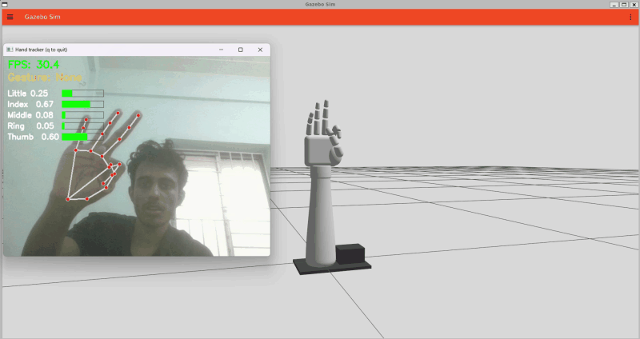
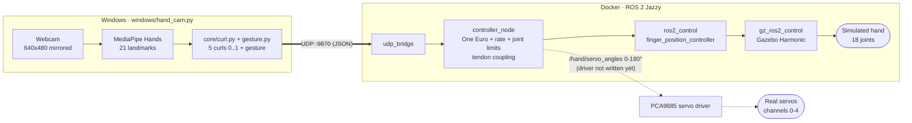
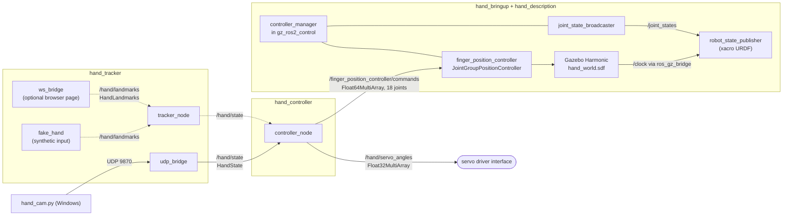
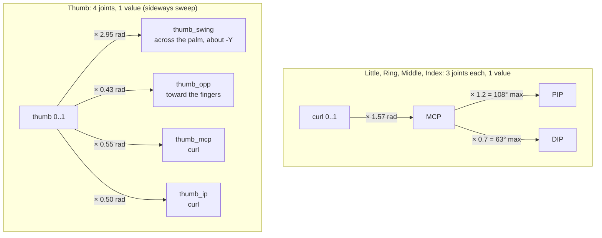

activate the virtual environment 

```bash
cd ~
source .venv/bin/activate
```

install mediapipe

```bash
pip install mediapipe
```

install additional  libraries for Reading webcam input and detecting hand gestures with opencv and moving servos via PCA9685 based on those gestures

```bash
pip install opencv-python numpy adafruit-circuitpython-pca9685 adafruit-circuitpython-servokit adafruit-blinka
```

run the python program 


```bash
python gesture_control.py
```

https://github.com/user-attachments/assets/d19e10fa-c630-4ead-9961-5617359b4335


---

## ROS 2 + Gazebo simulation (`ros2_sim/`)

A ROS 2 rebuild of this project, **simulation only** (no servo hardware needed): the same webcam + MediaPipe idea, but with proportional finger values, proper ROS 2 nodes and a simulated 3D-printed-style hand in Gazebo.



*Screen recording: the Windows preview (MediaPipe landmarks, FPS, gesture, five finger values) drives the simulated hand in Gazebo Harmonic.*

### Original script vs ROS 2 version

| | `gesture_control.py` (original) | `ros2_sim/` (ROS 2) |
|---|---|---|
| Finger value | open / closed (tip vs PIP `y`) → 0° or 180° | proportional **curl 0–1** from 3D joint angles (MCP + PIP + DIP flexion) |
| Hand orientation | image-`y` comparison | angles are **rotation-, scale- and mirror-invariant** (unit-tested, left/right hand) |
| Thumb | open/closed by `x` | **sideways sweep** of the tip along the palm's index→little axis; the simulated thumb swings across the palm |
| Smoothing | EMA 0.3 on the 0/180 target | **One Euro filter** per finger + rate limit + joint limits: 28% less jitter, 50% joint motion after 139 ms instead of 219 ms (`hand_controller`) |
| Wrist | none | 2 DOF (pronation, flexion) from MediaPipe world landmarks, geometry-tested against the forearm |
| Calibration | none | `o` open / `f` fist keys in `hand_cam.py`, saved to JSON |
| Grasping | none | grasp world: auto power/pinch grip from the nearest object; pen 5/5, cup 5/5, **ball 1/5 (unsolved)**, 5 trials each |
| Servo convention | PCA9685 channels 0–4 = Little, Index, Middle, Ring, Thumb; thumb reversed | **same**, published as degrees on `/hand/servo_angles` |
| Gestures | Fist, Pointing, Peace, Open Hand, Call Me | same five, rule-based on the curls |
| Structure | one script | 5 ROS 2 packages, nodes + topics, `ros2_control` position controllers, Gazebo model |
| Tests | none in this repo | 200+ (tracking math, wrist, calibration, UDP parsing, controller, grips, hand geometry) |
| Hardware | PCA9685 + servos | simulation only: there is no PCA9685 ROS driver node yet (dashed in diagram 1) |

### 1. Pipeline



### 2. ROS 2 packages, nodes and topics



Message types (`hand_interfaces`): `HandLandmarks` (21 points), `HandState` (valid, handedness, gesture, `curl[5]`). Dashed = alternative inputs (`./run.sh input:=browser` / `input:=fake`).

### 3. The hand model (`hand_description`, xacro URDF)

One value per finger drives all of its joints, like a tendon. In simulation the controller applies these ratios and commands all 16 joints (Gazebo's DART ignores URDF `<mimic>`).



The thumb sits low on the palm's side and points sideways about 70° from the index finger when open; closing it swings it across the front of the palm, under the curled fingers. Meshes are procedural (`ros2_sim/src/hand_description/scripts/gen_meshes.py`), the geometry tests check that the thumb does not clip the palm or fingers.


### Run it

Needs Docker Desktop (WSL2 backend, WSLg for the Gazebo window), a local image `gurdy2/ros:jazzy` (ROS 2 Jazzy, Gazebo Harmonic, ros2_control, `ros_gz`; the `ros2_sim/Dockerfile` builds on it) and Python 3.11 on Windows. The webcam runs on Windows because WSL2/Docker cannot see it.

**1. WSL** (builds the workspace in Docker, opens Gazebo, waits for finger values):

```bash
cd ~/projects/robotic_prosthetic_hand/ros2_sim
./run.sh                 # ./run.sh input:=fake = no camera, animated synthetic hand
./run.sh grasp:=true auto_grip:=true   # grasp world; a fist near the ball/cup/pen picks power/pinch grip
```

**2. Windows, one-time setup** (PowerShell; details in [`ros2_sim/windows/README.md`](ros2_sim/windows/README.md)):

```powershell
winget install Python.Python.3.11
robocopy \\wsl.localhost\Ubuntu\home\mahadev\projects\robotic_prosthetic_hand\ros2_sim C:\hand_ros2 /E /XD .git build install log .venv
cd C:\hand_ros2\windows
py -3.11 -m venv .venv
.\.venv\Scripts\Activate.ps1
pip install -r requirements.txt        # mediapipe 0.10.14, opencv-python 4.10, numpy 1.26
```

**3. Windows, every time:**

```powershell
cd C:\hand_ros2\windows
python hand_cam.py                     # preview; o = calibrate open hand, f = fist, r = reset, q = quit
```

Tests: `cd ros2_sim/src/hand_tracker && python -m pytest` (needs only numpy + pytest), same in `hand_controller`; the geometry tests run in the ROS image (see [`ros2_sim/README.md`](ros2_sim/README.md)).

**Tech stack:** ROS 2 Jazzy · Gazebo Harmonic (`gz_ros2_control`, `ros_gz`) · `ros2_control` · xacro/URDF · MediaPipe Hands 0.10.14 · OpenCV · NumPy · Docker (WSL2 + WSLg) · pytest · Python 3.11 (Windows) / 3.12 (container).
