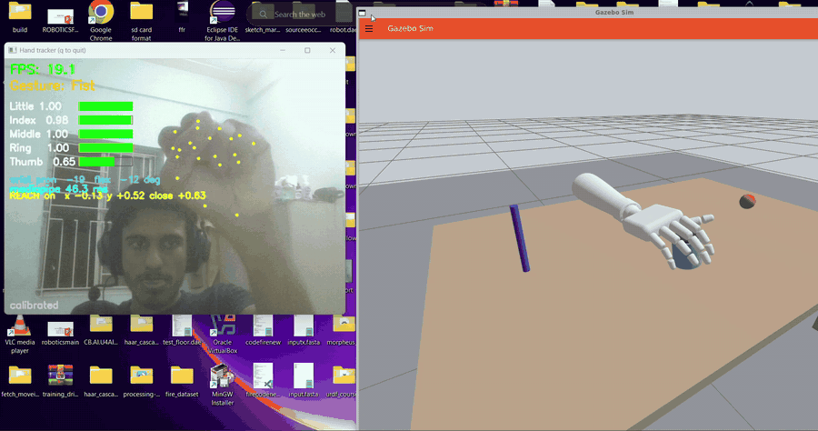
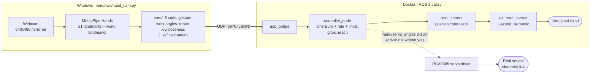
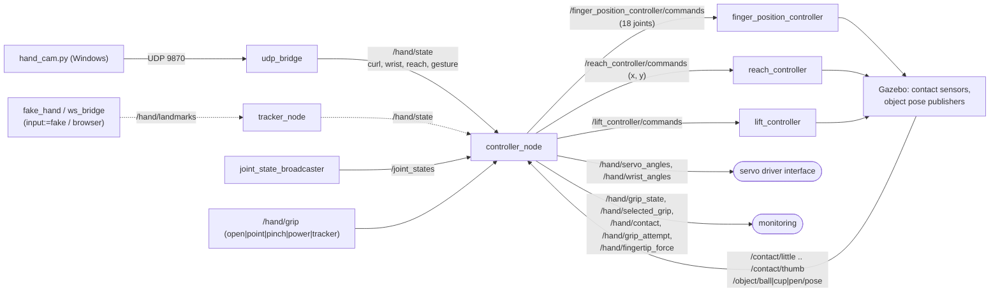
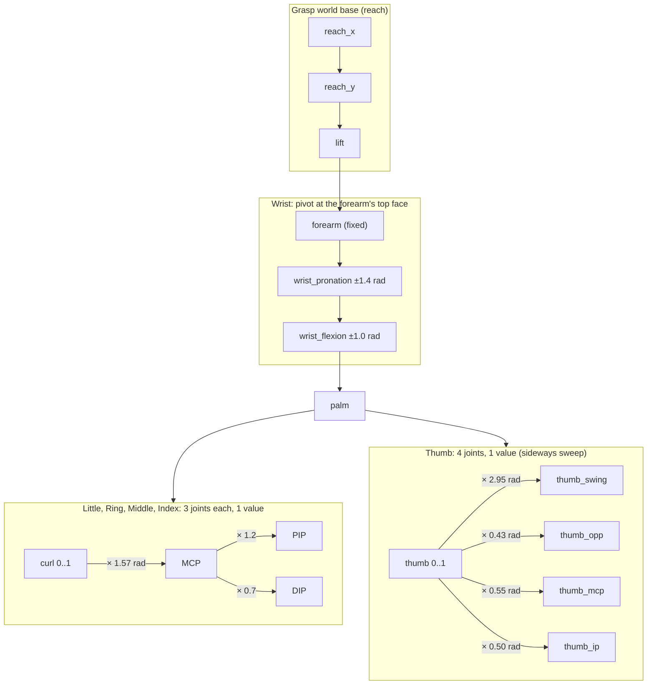
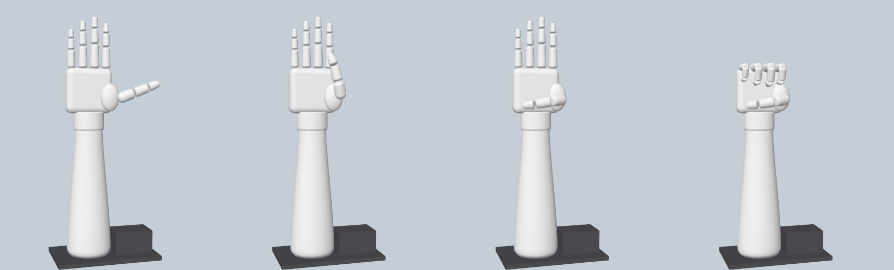

activate the virtual environment 

```bash
cd ~
source .venv/bin/activate
```

install mediapipe

```bash
pip install mediapipe
```

install additional  libraries for Reading webcam input and detecting hand gestures with opencv and moving servos via PCA9685 based on those gestures

```bash
pip install opencv-python numpy adafruit-circuitpython-pca9685 adafruit-circuitpython-servokit adafruit-blinka
```

run the python program 


```bash
python gesture_control.py
```

https://github.com/user-attachments/assets/d19e10fa-c630-4ead-9961-5617359b4335


---

## ROS 2 + Gazebo simulation (`ros2_sim/`)



*Live from my webcam: MediaPipe tracks my hand, reach control moves the sim hand over the cup, a fist triggers the auto power grip and the cup is lifted (Gazebo, right).*


*Screen recording: the Windows preview (MediaPipe landmarks, FPS, gesture, five finger values) drives the simulated hand in Gazebo Harmonic.*

A ROS 2 rebuild of this project, **simulation only** (no servo hardware needed): the same webcam + MediaPipe idea, but with proportional finger values, a wrist, reach control and grasping, proper ROS 2 nodes, and a simulated 3D-printed-style hand in Gazebo Harmonic. MediaPipe runs on Windows (WSL2/Docker cannot see the webcam) and sends its results over UDP to the ROS 2 nodes in Docker.

### Features

- **Proportional finger curl 0-1** from 3D joint angles (MCP + PIP + DIP flexion), invariant to hand rotation, scale and mirroring (unit-tested, left and right hand).
- **Sideways thumb**: its value is how far the tip sweeps across the palm along the index-to-little-knuckle axis; the simulated thumb swings across the palm.
- **2-DOF wrist** (pronation/supination, flexion/extension) from the MediaPipe world landmarks; the geometry is tested so the hand never cuts into the forearm over the whole range.
- **Reach control** (grasp world): palm position in the image moves the hand over the table, apparent hand size sets the height; dead zone, One Euro smoothing, workspace limits.
- **Auto-grip with force-limited closing**: a fist near an object picks power (ball, cup) or pinch (pen); each finger stops when its fingertip force reaches 2 N or when it is blocked; power grasps are verified and retried.
- **One Euro smoothing** per finger and wrist angle (replaces the EMA).
- **Per-user calibration**: `o` (open hand) and `f` (fist) rescale each finger, saved to JSON.
- **Tendon-coupled hand, 18 joints** (12 finger, 4 thumb, 2 wrist; +3 base joints in the grasp world): one value per finger drives MCP/PIP/DIP, one thumb value drives its four joints.
- Gestures: Fist, Pointing, Peace, Open Hand, Call Me, plus Pinch.

### Original script vs ROS 2 version

| | `gesture_control.py` (original) | `ros2_sim/` (ROS 2) |
|---|---|---|
| Finger value | open / closed (tip vs PIP `y`) -> 0 or 180 deg | proportional **curl 0-1** from 3D joint angles |
| Hand orientation | image-`y` comparison | angles are rotation-, scale- and mirror-invariant |
| Thumb | open/closed by `x` | sideways sweep of the tip along the palm's index->little axis |
| Wrist / position | none | 2-DOF wrist; reach control of the hand base (grasp world) |
| Smoothing | EMA 0.3 on the 0/180 target | One Euro filter + rate limit + joint limits |
| Calibration | none | `o` / `f` per-user calibration |
| Servo convention | PCA9685 channels 0-4 = Little, Index, Middle, Ring, Thumb; thumb reversed | same, published as degrees on `/hand/servo_angles` |
| Gestures | Fist, Pointing, Peace, Open Hand, Call Me | same five + Pinch |
| Grasping | none | grasp world with auto-grip |
| Structure | one script | 5 ROS 2 packages, `ros2_control` position controllers, Gazebo model |
| Tests | none in this repo | ~210 (tracking math, wrist, calibration, reach, UDP parsing, controller, grips, hand geometry) |
| Hardware | PCA9685 + servos | simulation only: there is no PCA9685 ROS driver node yet (dashed in diagram 1) |

### Results

Measured in the headless simulation on one machine ([details and caveats](ros2_sim/docs/results/README.md)).

| | before | after |
|---|---|---|
| UDP packet -> index joint at 50% in Gazebo (median) | 219 ms | **139 ms** |
| Jitter: std of the joint command, still hand + synthetic 0.03 curl noise | 0.0154 | **0.0111** (-28%) |
| Lag on a 1 Hz finger motion | 65 ms | **55 ms** |
| Scripted grasp, 5 trials each: pen / cup / ball | 3/5 / 4/5 / 0/5 | **5/5 / 5/5 / 1/5** |

The improvement comes from replacing the EMA (+ 4 curl/s rate limit) with a One Euro filter (+ 10 curl/s). Lag on continuous motion only improved by 5-10 ms; the noise is synthetic, real MediaPipe jitter will differ. Five trials per object is a small sample, and the "before" grasp numbers come from an earlier build.

Tracker speed (`tracker.process()`, 640x480 synthetic frames, CPU unless noted): MediaPipe 65 FPS (13 ms median), classic 93 FPS (9.5 ms), own YOLO 18 FPS CPU (53 ms) / 105 FPS CUDA (9 ms). No camera capture time included; no measurement on Windows with a real webcam.

### YOLO experiment (own hand tracker, not the default)

I trained a YOLO11n-pose hand model (21 keypoints, ONNX, `hand_cam.py --tracker yolo`) and compared it with MediaPipe and a classic skin/contour tracker.

| | hand found | curl MAE | open/closed agreement |
|---|---|---|---|
| 3000 held-out dataset images: yolo | 99.9% | 0.081 | **95.3%** |
| same, MediaPipe (reference) | 100% | ~0.03 | ~99.5% |
| same, classic | 100% | 0.437 | 61.8% (majority guess 76%) |
| my webcam clip, yolo before self-distillation | **72%** (MediaPipe 93%) | 0.274 | **68.1%** (keypoint error 11.4%) |
| my webcam clip, after self-distillation | **100%** | 0.185 | **77.5%** (keypoint error **5.6%**) |

Self-distillation = fine-tuning on 271 frames of my own clips auto-labelled by MediaPipe.
**Why MediaPipe stays the default:** the dataset labels were produced by MediaPipe, so every "error" is difference from MediaPipe, and the model can at best imitate its teacher; it has no depth (no metric curl, no wrist angle); it is slower on CPU; the self-distillation test uses the same person, room and camera as the training clips; the GPU path was only run with CUDA on Linux, not DirectML on Windows. **Next step (not done):** a two-stage design, a detector to crop the hand followed by a landmark model, to fix small hands in the frame.

### 1. Pipeline



### 2. ROS 2 nodes and topics



`reach_controller` and `lift_controller` exist only in the grasp world (`grasp:=true`).

### 3. The hand model



The thumb sits low on the palm's side and points sideways about 70° from the index finger when open; closing it swings it across the front of the palm. Gazebo's DART ignores URDF `<mimic>`, so in simulation the controller applies the ratios and commands every joint.



### Limitations

- **Ball grasp is not solved** (1/5): the closing fingers push the ball under the palm and off the table. The pen demo with reach control failed (the arriving hand knocked it over); the cup works.
- **Reach height comes from the apparent hand size**, a rough depth cue that also changes when you rotate the hand or spread your fingers.
- **Simulation only**: no servo driver node, no real hardware. Object poses in the grasp world come from the simulator, not from perception.
- The wrist angles have no ground truth (no motion capture); calibration and reach keys were unit-tested but the keys need a live camera.
- Grasp results: 5 trials per object, scanned object spots, one build per column.

### Run it

Needs Docker Desktop (WSL2 backend, WSLg for the Gazebo window), a local image `gurdy2/ros:jazzy` (ROS 2 Jazzy, Gazebo Harmonic, ros2_control, `ros_gz`; `ros2_sim/Dockerfile` builds on it) and Python 3.11 on Windows.

**1. WSL** (builds the workspace in Docker, opens Gazebo, waits for finger values):

```bash
cd ~/projects/robotic_prosthetic_hand/ros2_sim
./run.sh                                  # ./run.sh input:=fake = no camera, animated hand
./run.sh grasp:=true auto_grip:=true      # grasp world: reach + auto-grip
```

**2. Windows, one-time setup** (PowerShell; details in [`ros2_sim/windows/README.md`](ros2_sim/windows/README.md)):

```powershell
winget install Python.Python.3.11
robocopy \\wsl.localhost\Ubuntu\home\mahadev\projects\robotic_prosthetic_hand\ros2_sim C:\hand_ros2 /E /XD .git build install log .venv
cd C:\hand_ros2\windows
py -3.11 -m venv .venv
.\.venv\Scripts\Activate.ps1
pip install -r requirements.txt
```

**3. Windows, every time:**

```powershell
cd C:\hand_ros2\windows
python hand_cam.py            # add --reach to start with reach control on
```

Keys in the preview window: **`o`** calibrate open hand, **`f`** calibrate fist, **`r`** clear calibration, **`m`** reach on/off, **`c`** re-centre reach, **`q`** quit. Grasp: press `m`, hold your hand comfortably and press `c`, move over the cup, bring the hand closer to the camera to lower it, make a fist, move back to lift, open to release.

Tests: `cd ros2_sim/src/hand_tracker && python -m pytest` (numpy + pytest; 3 tests need `onnxruntime`), same in `hand_controller`; geometry tests run in the ROS image (see [`ros2_sim/README.md`](ros2_sim/README.md)).

**Tech stack:** ROS 2 Jazzy · Gazebo Harmonic (`gz_ros2_control`, `ros_gz`) · `ros2_control` · xacro/URDF · MediaPipe Hands 0.10.14 · OpenCV · NumPy · YOLO11 / ONNX Runtime (experiment) · Docker (WSL2 + WSLg) · pytest · Python 3.11 (Windows) / 3.12 (container).
