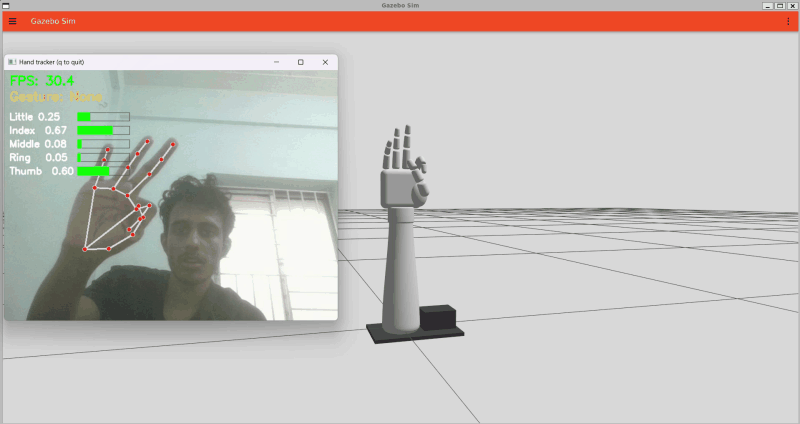
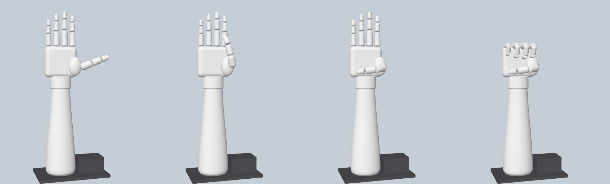
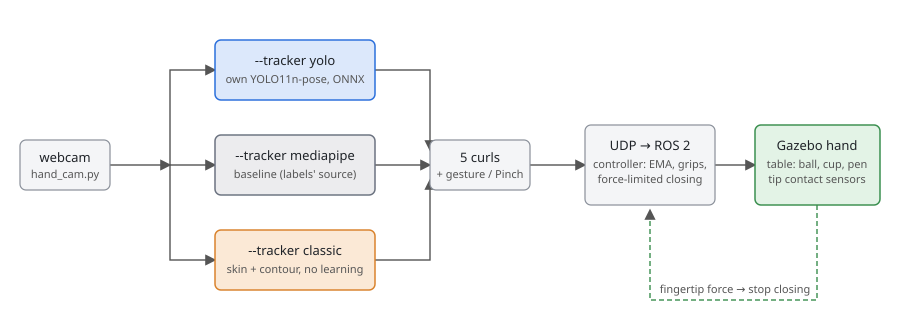

# ros2_sim (ROS 2 + Gazebo version)

ROS 2 Jazzy, simulation-only version of a robotic prosthetic hand: camera -> MediaPipe -> proportional
finger curl + gestures -> joint commands -> simulated hand (RViz / Gazebo Harmonic).
Original single-file version: https://github.com/mrsssok2/robotic_prosthetic_hand



Status: steps 1-6 of 8 plus the second iteration below (see [docs/design.md](docs/design.md)); metrics, video-file input and CI come next.




## Improvements (second iteration)

Full tables, method and caveats: [docs/results/README.md](docs/results/README.md).

| | before | after |
|---|---|---|
| UDP -> joint at 50% (median) | 219 ms | **139 ms** |
| jitter, still hand with 0.03 curl noise (std of the command) | 0.0154 | **0.0111** (-28%) |
| lag on 1 Hz finger motion | 65 ms | 55 ms |
| grasp, 5 trials: pen / cup / ball | 3/5 / 4/5 / 0/5 | **5/5 / 5/5 / 1/5** (auto grip: power for ball and cup, pinch for the pen) |

The ball is **not solved** (1/5) and 5 trials per cell is a small sample; details and limits in the results page.

**Grips and grasp world** (`hand_controller/grips.py`, `./run.sh grasp:=true auto_grip:=true`): open, point, pinch, power; a fist/pinch near an object picks the grip from the object (wide -> power, thin -> pinch). Closing stops per finger on fingertip force >= 2 N or when the finger is blocked; power grasps are verified and retried. Scripted test: `scripts/grasp_test.py`.

**Wrist** (2 DOF, `wrist_pronation` / `wrist_flexion`): from MediaPipe world landmarks (palm normal, wrist -> middle-knuckle direction), relative to a calibrated neutral; joint limits +-1.4 / +-1.0 rad; the geometry test checks the hand never cuts into the forearm over the whole range. No ground truth for the angles (no mocap): signs/ranges verified on synthetic hands and a real clip only.

**Calibration**: in the `hand_cam.py` preview press `o` (hand open) and `f` (fist); saved to `calibration.json`, per finger open -> 0, fist -> 1, wrist neutral from the open pose. Unit-tested, not tried with a live webcam.

**Smoothing**: One Euro filter per finger and wrist angle replaces the EMA (`smoothing:=ema` for the old one).

## Experiment: own YOLO11 tracker (not the default)

**Decision: MediaPipe is the live tracker** (`hand_cam.py` default). The YOLO11 and classic trackers are kept as documented experiments: `--tracker yolo|classic` swaps them in and the rest of the pipeline is unchanged. Honest summary: the YOLO model never beat MediaPipe. It is trained on labels *produced by MediaPipe*, so it can at best imitate its teacher (it reaches ~6% keypoint error and 95% open/closed agreement on held-out dataset images, 5.6% / 77.5% on a real webcam clip after fine-tuning on MediaPipe-labelled clips of the same room and person); it has no depth, so no metric curl or wrist angle; it is slower on CPU (18 vs 65 FPS); the GPU path was only run on CUDA in Linux, not on Windows with DirectML. What it was good for: a complete train -> ONNX -> evaluate -> compare loop and a measured answer.



- **yolo**: YOLO11n-pose trained on the Ultralytics hand-keypoints dataset (21 keypoints) on the RTX 4050, exported to ONNX
  (`models/hand_pose_n640.onnx`, runs with onnxruntime only): 23 epochs at 320, then 15 epochs fine-tuned at 640 on webcam-style composites (small hands, backlight). Training: `tracking/train_yolo.py`; live debugging: `tracking/compare_live.py`. On small hands the first model lost the hand (found 64% at 0.4 of frame height, 6% at 0.25); the fine-tuned one finds it 100%, but fingertips of extended fingers (e.g. pointing) are still often under-reached, see `docs/results/compare/`.
- **classic**: skin segmentation + palm centre + radial profile -> open/closed per finger (`trackers/classic_tracker.py`).
- **Honest caveat:** the dataset labels were produced by MediaPipe, so "error" means "difference from MediaPipe", and MediaPipe scores ~0 against its own labels.

| (3000 held-out images) | hand found | keypoint NME | curl MAE | open/closed acc. | FPS 640x480 | latency p50 |
|---|---|---|---|---|---|---|
| yolo n640 (ONNX, CPU / CUDA) | 99.9% | 5.9% of box diag | 0.081 | 95.3% | 18 / 105 | 53 / 9 ms |
| mediapipe (CPU) | 100% | ~0.7% (reference) | ~0.03 (reference) | ~99.5% | 65 | 13 ms |
| classic (CPU) | 100% | n/a | 0.437 | 61.8% (majority guess: 75.9%) | 93 | 10 ms |

UDP packet to the Gazebo hand reaching 50% closure: 226 ms median (mostly the controller's smoothing); add the tracker latency for end to end (about 240-255 ms, no camera).
**Real webcam clip (own 45 s recording, held out) and self-collected distillation:** the dataset-trained model found the hand in 72% of frames (MediaPipe 93%), keypoint error 11.4%, curl MAE 0.274, open/closed agreement 68.1%. Fine-tuned on 271 frames auto-labelled by MediaPipe from two other clips of the same setup (mixed with the original data, `tracking/make_selfcollected_dataset.py`), `models/hand_pose_n640_self.onnx` gets found 100%, keypoint error 5.6%, curl MAE 0.185, open/closed 77.5%, with no regression on the 3000 dataset test images (NME 6.18%, open/closed 95.2%). Caveats: same person, room and camera as the training clips, teacher is MediaPipe, one run; details in [docs/results/self_distill.md](docs/results/self_distill.md). Use it with `--model models/hand_pose_n640_self.onnx` (the default model is unchanged).
Windows GPU: `--device auto|cuda|dml|cpu` (DirectML via `onnxruntime-directml`, CPU fallback); implemented and unit-tested with a fake onnxruntime, not yet run on a Windows GPU.
Not done: evaluation in other rooms / with other people (and the base YOLO was stopped at 23/60 epochs)
Full tables, per-finger numbers and caveats: [docs/results/README.md](docs/results/README.md).

## Run it (webcam -> Gazebo hand)

MediaPipe (Python, like the original `gesture_control.py`) runs on **Windows**, because WSL2/Docker cannot
see the webcam. It sends the five finger values over UDP to the ROS bridge in Docker.

1. WSL: `cd ~/projects/robotic_prosthetic_hand/ros2_sim && ./run.sh` (builds in Docker, opens Gazebo; `./run.sh input:=fake` = no camera)
2. Windows: one-time setup and `python hand_cam.py` -> [windows/README.md](windows/README.md)

Optional alternative: `./run.sh input:=browser` and open http://localhost:8765/ (MediaPipe JS in the browser).
Needs the `gurdy2/ros:jazzy` image and Docker Desktop with WSLg.

```
hand_cam.py -udp 9870-> udp_bridge -/hand/state-> controller_node -+-> /hand/servo_angles (0-180 deg, ch 0-4, thumb reversed)
(Windows)                                                           +-> /finger_position_controller/commands -> Gazebo (18 joints: 12 finger, 4 thumb, 2 wrist)
```

Test the ROS side without any camera: `scripts/fake_udp.py 0 0 0 0 1` (little index middle ring thumb, 0..1; `--wrist 0.8 0.3` = pronation, flexion in rad; with no arguments it animates fingers and wrist).

### Try it live

```bash
# WSL: simulation (default world)                      # Windows: camera -> UDP (calibrate with o / f, quit with q)
cd ~/projects/robotic_prosthetic_hand/ros2_sim         cd C:\hand_ros2\windows ; python hand_cam.py
./run.sh
./run.sh grasp:=true auto_grip:=true      # grasp world: a fist / pinch near the ball, cup or pen picks power / pinch grip
./run.sh smoothing:=ema                   # the old EMA smoothing, to feel the difference
```

Measure it yourself (headless sim in a background container, `scripts/sim_up.sh [launch args]`, then `scripts/sim_exec.sh ...`):
`measure_latency.py`, `measure_jitter.py`, `grasp_test.py --trials 5` (see [docs/results](docs/results/README.md)).

## Tests

```bash
python3 -m venv .venv && . .venv/bin/activate && pip install numpy pytest
(cd src/hand_tracker && python -m pytest) && (cd src/hand_controller && python -m pytest)
# hand geometry (needs ROS for xacro):  docker run --rm -v $PWD:/home/ubuntu/hand_ros2 hand_ros2:jazzy bash -c \
#   'source /opt/ros/jazzy/setup.bash; cd ~/hand_ros2/src/hand_description && python3 -m pytest test'
```
