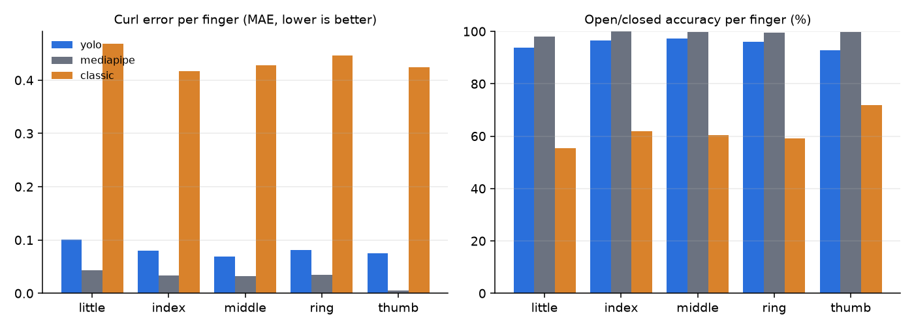
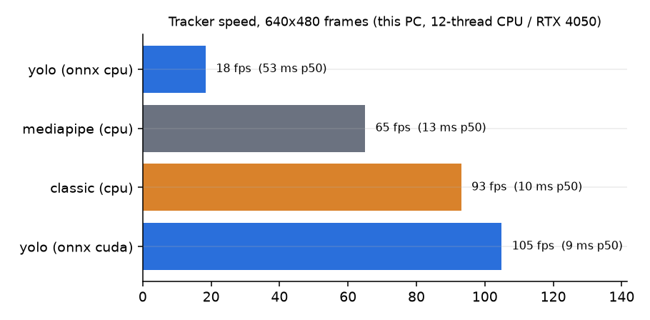

# Results

Own YOLO11 hand-pose tracker vs the MediaPipe baseline vs a classic skin/contour tracker. Accuracy on **3000 held-out images** of the Ultralytics hand-keypoints dataset (never used for training or checkpoint selection); model `hand_pose_n640.onnx`.

## Read this first: the labels come from MediaPipe

The Ultralytics hand-keypoints dataset was auto-labelled by running MediaPipe Hands on the images. So every "error" below is error **against MediaPipe's output**, not against human annotation or true joint angles. MediaPipe's own row is ~0 by construction (it reproduces its own labels), which says nothing about its real accuracy. The YOLO model can at best imitate MediaPipe; the numbers measure how well it does. The curl reference is computed from the label keypoints with the same 2-D curl code (no depth), for every tracker.

## Accuracy vs the (MediaPipe-derived) labels

| tracker | hand found | keypoint NME (% of box diag) | PCK@0.05 | curl MAE (0-1) | open/closed acc. |
|---|---|---|---|---|---|
| yolo | 99.9% | 5.92 | 77.9% | 0.081 | 95.3% |
| mediapipe | 100.0% | 0.66 | 98.7% | 0.030 | 99.5% |
| classic | 100.0% | n/a | n/a | 0.437 | 61.8% |
| *always-open / majority guess* | - | - | - | - | 76.0% |

A missed detection counts as wrong for open/closed accuracy. Closed = curl >= 0.5. The classic tracker has no keypoints, so no keypoint error. Classic thresholds were tuned on the validation split, not the test images.

Per-finger curl MAE:

| tracker | little | index | middle | ring | thumb |
|---|---|---|---|---|---|
| yolo | 0.101 | 0.080 | 0.069 | 0.081 | 0.076 |
| mediapipe | 0.043 | 0.033 | 0.033 | 0.035 | 0.005 |
| classic | 0.468 | 0.417 | 0.428 | 0.447 | 0.425 |

## Speed and latency

`tracker.process()` on 640x480 frames (hand crops pasted on a grey canvas; 300 frames after warm-up), Linux container, same machine for all. Not measured on Windows with a real webcam.

| tracker | FPS | latency mean | p50 | p95 |
|---|---|---|---|---|
| yolo (onnx cpu) | 18.4 | 54.3 ms | 53.1 ms | 63.8 ms |
| mediapipe (cpu) | 65.0 | 15.4 ms | 13.0 ms | 27.1 ms |
| classic (cpu) | 93.1 | 10.7 ms | 9.5 ms | 21.9 ms |
| yolo (onnx cuda) | 104.9 | 9.5 ms | 8.9 ms | 15.4 ms |

### Latency to the Gazebo hand

One 'all fingers closed' UDP packet, 12 trials, wall clock (`scripts/measure_latency.py`). Includes the controller's smoothing (EMA 0.3 + rate limit 4 curl/s), which is deliberate lag. Excludes camera capture and the tracker.

| stage | median | p95 |
|---|---|---|
| UDP -> /hand/state | 2 ms | 4 ms |
| -> first joint command change | 8 ms | 17 ms |
| -> index MCP at 50% in Gazebo | 226 ms | 240 ms |
| -> index MCP at 90% in Gazebo | 414 ms | 446 ms |

End to end (tracker p50 + time to 50% closure), excluding camera capture:

| tracker | tracker p50 | + to 50% closure | = |
|---|---|---|---|
| yolo (onnx cpu) | 53 ms | 226 ms | 279 ms |
| mediapipe (cpu) | 13 ms | 226 ms | 239 ms |
| classic (cpu) | 10 ms | 226 ms | 235 ms |
| yolo (onnx cuda) | 9 ms | 226 ms | 234 ms |

## Grasp test (Gazebo, scripted)

Hand reaches over a table palm-down; fingertip contact sensors + joint effort limit (0.10 N m) bound the closing force; success = object rises >= 7 cm with the hand and stays within 8 cm of its grasp pose relative to the palm, 1.5 s after a 10 cm lift. Object start position is jittered by +-6 mm / +-3 mm.

| object | grip | success | settled | released on open | peak fingertip force (N, max over trials) |
|---|---|---|---|---|---|
| pen | pinch | 3/5 | 5/5 | 5/5 | 8.2 |
| cup | pinch | 4/5 | 5/5 | 5/5 | 2.8 |
| ball | pinch | 0/5 | 5/5 | 5/5 | 8.4 |
| ball | power | 0/5 | 5/5 | 5/5 | 8.2 |

## Limits and caveats

- **No webcam clips.** The build machine (WSL2) has no camera and no recorded hand clips existed, so accuracy is on dataset images, and speed on synthetic 640x480 frames. `tracking/record_clip.py` (Windows) records clips and `tracking/evaluate.py --clips DIR` scores all three trackers against MediaPipe on them; that has not been run.
- **YOLO was trained for 23 of the planned 60 epochs** (stopped for time; mAP50-95 pose ~0.81 on the validation split, still rising). Dataset images are tight hand crops; a hand that is small in a webcam frame is a domain gap that is not measured here.
- **Classic tracker is below the majority-class guess** on open/closed (it is a deliberately simple baseline; thresholds hand-tuned on a few hundred validation images). It assumes a plain background and a visible forearm.
- **Curl uses 2-D keypoints** for all trackers here (foreshortening under-reads curl); the live MediaPipe path in `hand_cam.py` uses metric world landmarks.
- **Grasping:** only a pinch grip lifts objects. Ball: 0/5 with pinch and with power - the ball gets pushed off the table. The power grip never held anything: the 3-segment finger with fixed tendon ratios cannot cage an object against a flat palm. Object positions were found by scanning, so success rates are for tuned spots, 5 trials each. Fingertip forces include contact impulses (peaks up to 8 N); the steady limit is the 0.10 N m joint effort cap (~2.5 N at the tip). The cup collision is a solid cylinder (visual is an open cup).
